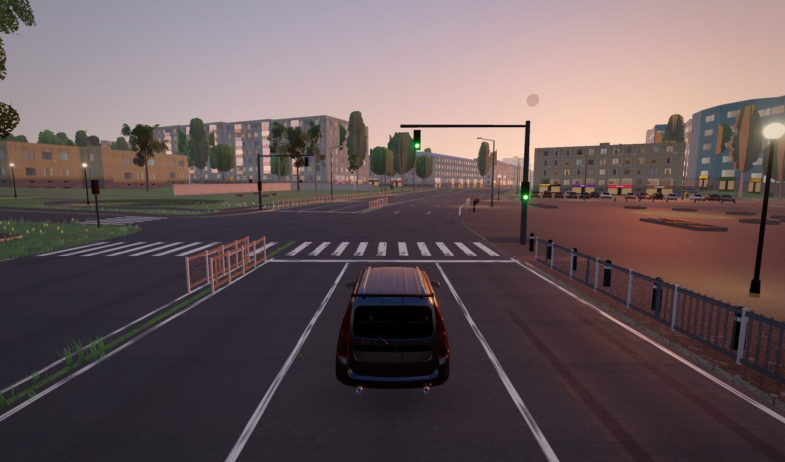
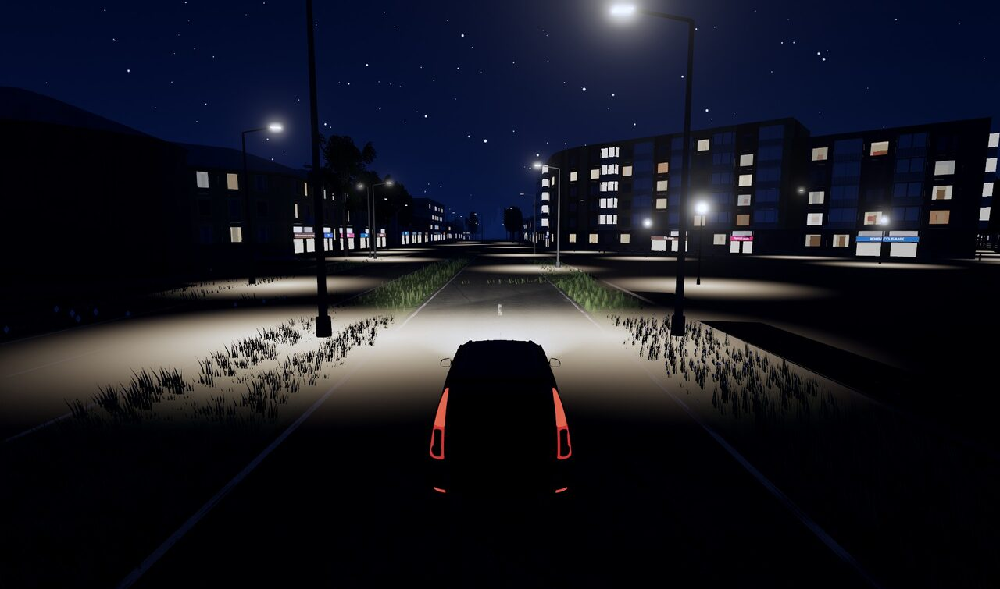
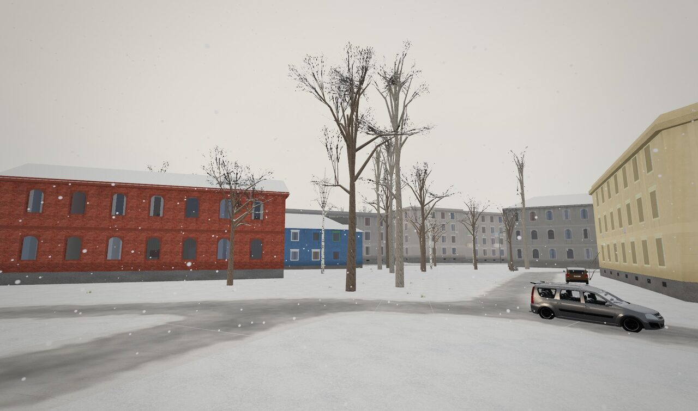
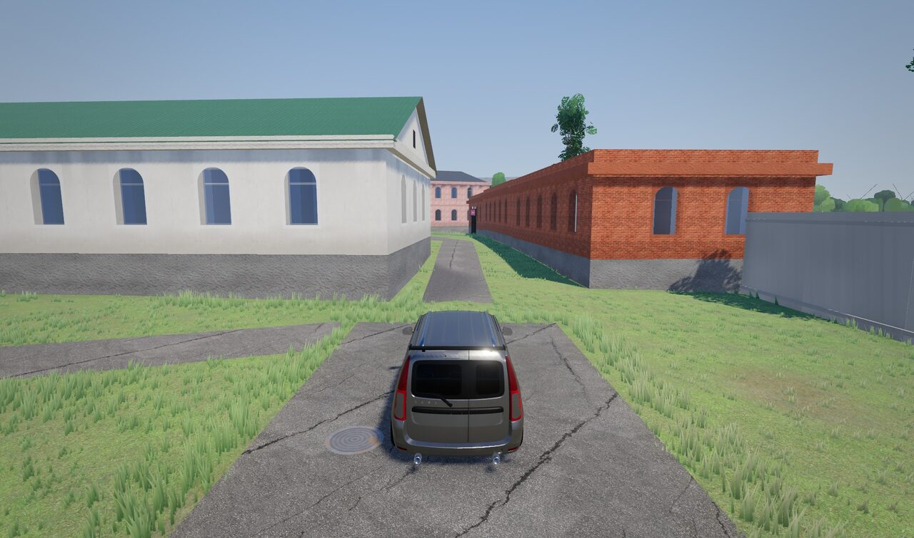
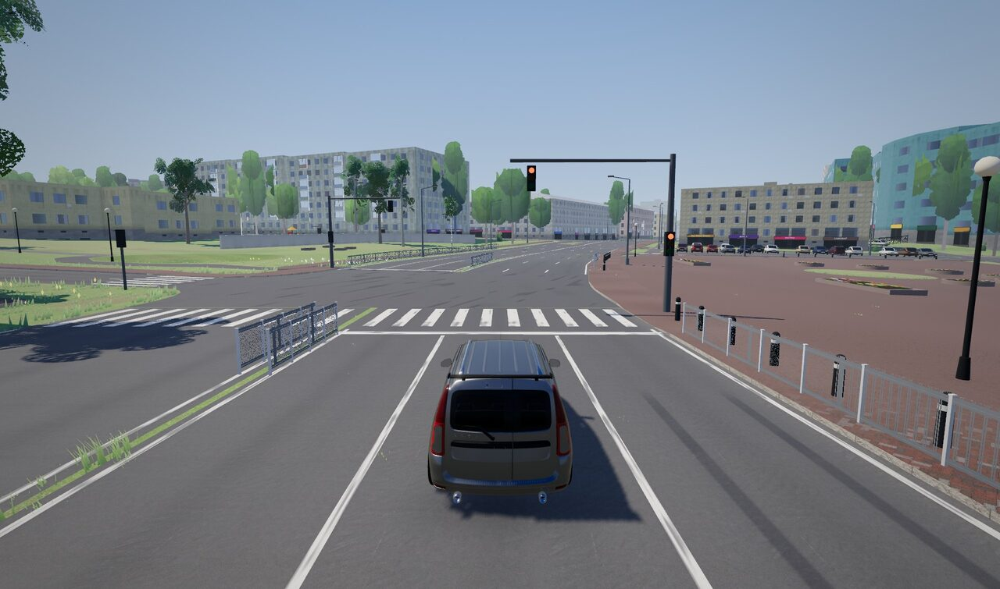

# Need for Ryazan

Браузерная аркадная гонка с открытым миром в духе Need for Speed: центр Рязани в реальном масштабе
(1 юнит = 1 м, реальная геопривязка и рельеф), трафик по полосам и светофорам, пешеходы, смена дня и ночи,
погода и времена года, пеший GTA-режим. Первая машина — тюнингованная Lada Largus.



| | |
|---|---|
|  |  |
|  |  |

## Стек

- **Игра** (`game/`): TypeScript, Vite, Three.js, Rapier (физика), Web Audio (гранулярный синтез двигателя).
- **Конвейер мира** (`pipeline/`): Python (uv) — OSM, рельеф, ортофото, реестр зданий → тайлы glTF + карта высот.
- **Ассеты** (`assets/scripts/`): Blender-скрипты для машин, пешеходов, ориентиров; сборка звуков.

## Запуск

```
cd game
npm install
npm run dev        # http://127.0.0.1:5173
```

Без собранного мира (`game/public/world/`, не хранится в репозитории) загружается тестовый мир;
`?world=synthetic` — синтетический город (`node scripts/gen-synthetic-world.mjs`).
Реальный мир собирается конвейером: см. `docs/stage1/pipeline.md`.

Управление и архитектура — [`game/README.md`](game/README.md). ТЗ — [`docs/TZ.md`](docs/TZ.md),
формат мира — [`docs/world-format.md`](docs/world-format.md), заметки по этапам — `docs/stage*/`.

## Лицензии ассетов

Сторонние модели, текстуры, анимации и звуки — CC0 / CC BY, авторы и ссылки перечислены в [`game/CREDITS.md`](game/CREDITS.md).
Картографические данные © участники OpenStreetMap (ODbL).
