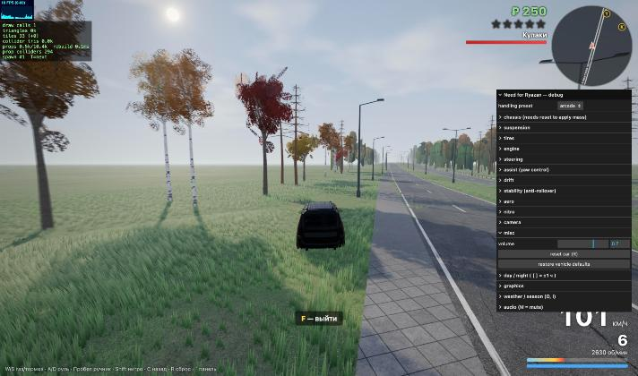

# Управляемость: аркада без «гроба на колёсах»

Жалоба: машина легко переворачивается на скорости и плохо рулится. Модель переделана и проверена стендом с замерами
(`game/scripts/handling/`). Код: `game/src/vehicle/vehicle.ts`, параметры: `game/src/vehicle/config.ts` (+ пресеты),
классы GTA-режима: `game/src/vehicle/classes.ts`, камера: `game/src/camera/chase-camera.ts`.

## Что было не так (по замерам)

Стенд показал 11 опрокидываний в 43 сценариях. Пример: ступенчатый руль на 100 км/ч, руль на половину: за 0.4 с
боковое ускорение доходит до 1.9 g, внутренние колёса разгружаются до нуля, ещё через 1.5 с машина лежит на боку.
Причины, по степени вклада:

1. **Центр масс стоял на 0.8 м над землёй, а не там, где задумано.** `setMassProperties` задаёт ЦМ в системе
   *коллайдера*, а коробка кузова сдвинута вверх. Поэтому Rapier ставил ЦМ в центр коробки. Статический коэффициент
   устойчивости (SSF = колея / (2·h)) получался 1.5 / 1.6 ≈ 0.94: машина опрокидывалась от поперечного ускорения меньше 1 g.
2. **Сцепление μ = 1.9 при полном руле на любой скорости.** Это 1.9–3 g бокового ускорения, вдвое выше порога
   опрокидывания. Руль на скорости выкручивал колёса далеко за пик сцепления. Отсюда «плохо рулится»: машина резко
   клевала в поворот, а скорость падала вдвое (100 → 52 км/ч за 4 с в полном руле).
3. Силы шин прикладывались в точке крепления подвески, на 0.25 м ниже фактического ЦМ. Получался кренящий момент без
   всякого ограничения.
4. Не было стабилизации крена. Угловое демпфирование было общим (0.6), в воздухе машину ничто не выравнивало: прыжок с
   одной стороны на 140 км/ч заканчивался на крыше.
5. Пятно контакта — один луч. На ступеньке колесо скачком «запрыгивало» на бордюр. Нормаль кромки (до 72° от
   вертикали) поворачивала плоскость шины, и боковая сила начинала поднимать кузов. Занос боком в бордюр на 70 км/ч
   заканчивался опрокидыванием.
6. Руль: помощь сводилась к постоянному моменту рыскания на единицу руля, стабилизация работала только при руле в
   нуле. Дрифт не держался: угол заноса не больше 12°, сразу выход, `timeInDrift = 0`.

## Что изменилось

**Масса и геометрия.** ЦМ задаётся явно: `chassis.comHeight` (0.5 м, заниженный Largus) и `comOffsetZ`. Масса и ЦМ
применяются при создании машины и при `reset()`. Кузов — скруглённая коробка (`roundCuboid`, r = 0.12 м), чтобы не
цеплялся острой кромкой.

**Подвеска.** Три луча на колесо вдоль окружности шины (`suspension.probes`). Колесо «накатывается» на ступеньку, а не
прыгает на неё. Сила подвески ограничена (`maxForce` × статическая нагрузка), поэтому нет выстрела при спавне в земле и
на бордюрах. Отбойник настраивается (`bumpStop`). Нормали круче ~45° (кромки, стены) опорой не считаются.

**Шины.** Силы шин считаются в плоскости шасси, поэтому кромки и склоны не «поддомкрачивают» кузов. Боковые силы
приложены на высоте `ЦМ − forceLever·h`, продольные — `ЦМ − forceLeverLong·h`. Это аркадный приём: крен и клевок
видны, но кренящий момент ограничен. Эффективный SSF ≈ 1.5 / (2·0.5·0.5) = 3.0 при пределе сцепления ~1.6 g,
поэтому машина скользит раньше, чем опрокидывается. Остальное:
- кривая Пачейки с пиком около 10° и спадом до 77 % после пика;
- чувствительность к нагрузке (`loadSensitivity`);
- эллипс трения;
- **ABS**: тормоз не больше предела сцепления, боковая сила в приоритете, так что машина рулится при торможении;
- **TC** (`tractionControl`): ограничивает тягу вне дрифта.

**Руль и регулятор рыскания.**
- Скорость руля зависит от скорости: `response` → `responseHighSpeed`, возврат к центру — `returnResponse`.
- Предел угла зависит от скорости: `maxAngle` → `minAngle`. Кроме того, колёса не выворачиваются дальше пика
  сцепления (`steering.gripLimit`), поэтому полный руль на 180 км/ч — это поворот на пределе, а не срыв.
- Цель угловой скорости: `руль × min(кинематика, aMax / v)`, где `aMax = latGripUse·μ·g` (с учётом погоды).
- Регулятор (`yawGain`, `yawAccelMax`) тянет к цели. Отсюда отклик за 0.17–0.2 с, стабилизация на прямой и гашение
  избыточной поворачиваемости.
- Мягкий предел угла увода (`slipLimit`) и автоконтрруль (`counterSteer`).

**Дрифт** (`drift.*`) — отдельное состояние со своим регулятором угла.
- Вход: ручник + руль, «тормоз + руль → газ» (окно `brakeArmTime`) или газ в пол при уже поехавшей корме
  (`powerOverSlip`).
- Удержание: целевой угол = `baseAngle + throttleAngle·газ ± steerAngle·руль (+ handbrakeAngle)`. Газ — больше
  угла, контрруль — меньше. Передние колёса сами смотрят по вектору скорости. `speedKeep` не даёт дрифту «съесть»
  скорость.
- Выход: отпустить газ и выпрямить руль. Сцепление задней оси возвращается плавно (`blendOut`), без «пилы».

**Стабилизация** (`stability.*`).
- На земле: выпрямляющий момент при крене больше `rollStart` относительно дороги, демпферы крена и тангажа. При крене
  больше `latCutStart` боковая сила режется: машина скользит, а не переворачивается.
- В воздухе: выравнивание крена и частично тангажа (`airUpright`, `airPitch`), гашение вращения. Машина приземляется
  на колёса.
- Машина на боку или крыше на малой скорости через 1.2 с сама встаёт на колёса (`selfRight`).
- Прижимная сила ∝ v² (`aero.downforce`) приложена в ЦМ.

**Камера.** К плавному следованию, учёту вектора скорости в заносе, FOV от скорости и нитро добавлен взгляд в поворот
(`lookIntoTurn`): точка взгляда смещается по угловой скорости машины.

**Классы GTA-режима** строятся тем же кодом и с тем же пресетом. Помощники заданы угловыми ускорениями и сами
масштабируются инерцией; по массе масштабируются только силы.
- Седан и ДПС: ЦМ 0.5 м, ДПС на 5 % цепче.
- Внедорожник: ЦМ 0.68 м, рычаг шин ×1.35. Заметный крен (4° против 3° у седана), но не переворачивается.
- Газель: ЦМ 0.8 м, μ ×0.88, мягкий дрифт.
- Автобус и троллейбус: ЦМ ≈ 1.1 м, μ ×0.78, медленный руль, регулятор слабее, дрифт выключен.

Погода (`weatherGrip`) умножает μ и цель регулятора. На мокрой дороге и снегу машина держит меньше, но остаётся
управляемой.

## Пресеты

Переключаются в панели lil-gui (`handling preset`) или параметром `?handling=arcade|sim-lite|drift`.
`applyHandlingPreset(cfg, name)` в `config.ts` сначала возвращает затронутые ключи к arcade-значениям, затем
накладывает отличия пресета. Машины, которые игрок берёт в GTA-режиме, создаются с текущим пресетом.

| Пресет | Суть | max боковое (140) | слалом | 0–100 | 100–0 | дрифт: угол / выход |
|---|---|---|---|---|---|---|
| arcade (по умолч.) | цепко, резкий отклик, дрифт по ручнику / тормозу | 1.63 g | 70 км/ч | 5.2 с | 26.7 м | 39° / 0.7 с |
| sim-lite | μ 1.2, больше крена, слабые помощники | 1.27 g | 60 км/ч | 5.8 с | 33.9 м | 38° / 0.75 с |
| drift | корма легче (μ 1.45 сзади, в дрифте ×0.5), угол до 55°, вход газом | 1.58 g | 70 км/ч | 5.6 с | 27.9 м | 46° / 0.8 с |

Во всех трёх пресетах — 0 опрокидываний на стенде. В пресете drift полный руль с газом на снегу ожидаемо уводит машину
в занос.

## Стенд (`game/scripts/handling/`)

- `harness.ts` — сценарии на своём полигоне: Rapier, 60 Гц, без рендера, детерминированно.
  - ступенчатый руль (половина и полный) на 60/100/140/180 км/ч;
  - слалом (конусы через 18 м, максимальная скорость прохождения);
  - ISO 3888-1 «переставка» (все 4 угла кузова в коридорах);
  - круг R = 40 м с ростом скорости;
  - 0–100, торможение 100–0 по прямой и в дуге;
  - бордюр 0.15 м под 30° и боком;
  - «лежачие полицейские», трамплин 0.5 м (ровный и под одну сторону);
  - разворот ручником, дрифт (вход ручником и тормозом, удержание, выход);
  - мокро и снег, все классы GTA-режима.

  Водитель-робот работает по принципу pure pursuit с PI по рысканию; на каждой скорости он пробует несколько упреждений.
- `run.mjs` — запуск в Node через vite SSR (весь набор ~6 с):
  ```
  cd game
  node scripts/handling/run.mjs                                  # всё, arcade
  node scripts/handling/run.mjs --preset drift --only drift      # пресет и фильтр
  node scripts/handling/run.mjs --set tires.gripFront=1.5 --set assist.yawGain=9   # подбор без правки кода
  node scripts/handling/run.mjs --vehicle-dir <копия src/vehicle> --out before.json # прогон другой версии
  node scripts/handling/run.mjs --compare before.json after.json # таблица до/после
  ```
- `street.ts` — реальные улицы в браузере. Робот едет по дороге из `roads/graph.json` и подгружает тайлы:
  `const m = await import('/scripts/handling/street.ts'); await m.runStreet(__game, 'Солотчинское шоссе', { kmh: 150 })`.

## До / после (arcade, Largus)

| Метрика | было | стало |
|---|---|---|
| Опрокидывания, все 43 сценария полигона | **11** | **0** |
| Ступенчатый руль 100 км/ч, половина: крен / боковое | 90° (на боку) / 2.46 g | 2.0° / 1.32 g |
| Полный руль 140 км/ч: крен / боковое / отрыв колёс | 90° / 2.94 g / да | 2.6° / 1.63 g / нет |
| Полный руль 180 км/ч | опрокидывание | 2.8°, 1.8 g, скорость 180 → 153 |
| Отклик рыскания T63 (100–140 км/ч) | 0.18 с (на 60 км/ч), дальше опрокидывание | 0.17 с |
| Слалом 18 м, макс. скорость | 85 км/ч (за счёт 2–3 g) | 70 км/ч (1.6 g) |
| Переставка ISO 3888, макс. скорость | 120 км/ч | 110 км/ч |
| Круг R40: макс. боковое / градиент крена | 1.70 g / 1.96 °/g | 1.56 g / 1.55 °/g |
| 0–100 | 4.85 с | 5.23 с (TC) |
| 100–0 по прямой / в дуге | 21.6 / 22.4 м (1.9 g) | 26.7 / 27.2 м (1.5 g, ABS) |
| Занос боком в бордюр 70 км/ч | опрокидывание | крен 5.2° |
| Трамплин под одно колесо, 140 км/ч | на крыше | крен 18.5°, приземление на колёса |
| Ровный трамплин 100 км/ч: тангаж при приземлении | 8.6° | 1.4° |
| Разворот ручником 60 км/ч, поворот за 1.5 с | 94° | 108° |
| Дрифт (ручник / тормоз): время в заносе / угол / выход | 0 с / 12° / — | 4.0 с / 39° / 0.7 с |
| Классы (седан, ДПС, Газель, ПАЗ, троллейбус), полный руль | 5 из 7 опрокидываются | 0 из 7 |
| Реальные улицы, робот 150–160 км/ч: Солотчинское ш. ×2, Северная окружная ×2 | 3 опрокидывания (Северная) | 0 (крен ≤ 26° после ударов об ограждения при уходе с линии) |

Скорость в слаломе и переставке ниже, чем было: прежние цифры получались за счёт нефизичных 2–3 g. Конус через 18 м на
80 км/ч требует ~2 g. Если нужна ещё более «липкая» аркада, поднимите `tires.gripFront/gripRear`. Запас по
опрокидыванию большой: SSF ≈ 3 и стабилизация.



## Как настраивать

- **Меньше и больше «липкости»**: `tires.gripFront/gripRear` (сзади чуть больше — недостаточная поворачиваемость,
  безопасно), `assist.latGripUse` (насколько полный руль приближается к пределу).
- **Крен и клевок (визуально)**: `tires.forceLever` / `forceLeverLong` (0 — нет, 1 — физично), `suspension.antiRoll`.
  Следите за SSF: `track / (2·comHeight·forceLever)` должен быть ≥ 1.5 × максимальное боковое.
- **Острота руля**: `steering.response`, `responseHighSpeed`, `minAngle`; `assist.yawGain` / `yawAccelMax`
  (0 — чистая шинная модель).
- **Занос вне дрифта**: `assist.slipLimit`, `counterSteer`.
- **Дрифт**: вход — `drift.powerOverSlip`, `brakeArmTime`; угол — `baseAngle`, `throttleAngle`, `steerAngle`,
  `maxAngle`; устойчивость — `angleGain`, `angleDamping`; выход — `exitAngle`, `blendOut`; скорость — `speedKeep`,
  `rearGrip`.
- **Переворачивания**: `stability.rollStart` / `rollStiffness` / `latCutStart`. В воздухе — `airUpright`,
  `airPitch`, `airDamping`.
- После изменения `chassis.*` (масса, ЦМ) нажмите R (reset).

Перед коммитом настроек прогоните `node scripts/handling/run.mjs` и сравните с предыдущим JSON (`--compare`).
